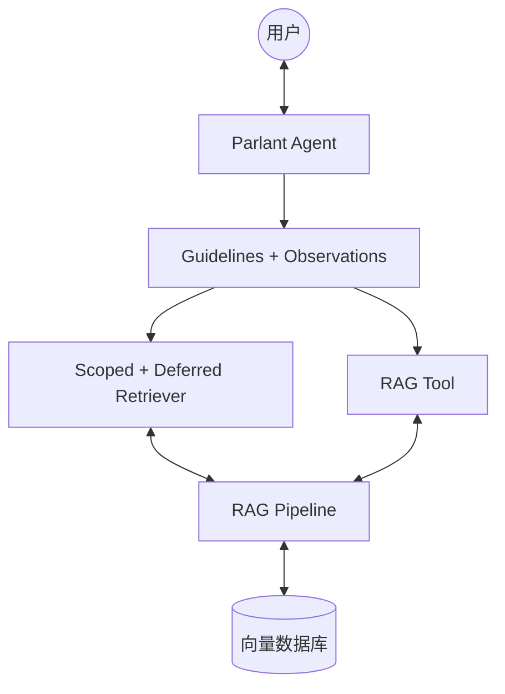

**✅ 「平衡版」架构**

这个平衡版在**保持结构清晰**的同时，**较好地利用了 Parlant 框架的核心特性**（Guidelines + Observations + Scoped + Deferred Retriever）。

### 平衡版架构图

---

### **各模块详细解释**

| 模块 | 名称 | 详细说明 | Parlant 特性利用程度 | 具体示例 |
|------|------|----------|---------------------|----------|
| **User** | 用户 | 真实使用系统的客户或内部员工，通过网页、App 或接口与 Agent 进行对话 | - | 用户输入：“公司 30 天退货政策是什么？” |
| **Agent** | Parlant Agent | **系统的核心大脑**。负责接收用户消息、协调所有组件、调用 Guidelines、组装上下文，最终生成回复 | 高 | 通过 `server.create_agent()` 创建的智能客服 Agent |
| **GL** | Guidelines + Observations | **规则引擎**。Guidelines 定义主要规则，Observations 作为补充（用于边缘情况或兜底逻辑） | **很高** | Guideline 示例： `condition="用户询问退货、会员权益、政策时"` Observation 示例： `condition="检索不到相关知识时"` |
| **SR** | Scoped + Deferred Retriever | **本方案的核心 RAG 实现方式**（强烈推荐）。 - **Scoped**：绑定到特定 Guideline，只在相关场景下生效 - **Deferred**：先并行检索，再根据上下文判断是否真正注入知识 | **最高**（充分利用 Parlant 上下文工程） | 用户问“退货政策” → Scoped Retriever 触发 → Deferred 判断后只注入退货相关内容，避免塞入无关的促销信息 |
| **Tool** | RAG Tool | **辅助检索工具**。使用 `@p.tool` 装饰器封装，当需要更强控制、多步推理或主动调用时使用 | 中 | 用户说“帮我查找最新版合同模板文档”时，Agent 主动调用 Tool 进行深度检索 |
| **RAG** | RAG Pipeline | **你自己实现的检索管道**（独立模块）。负责完整的检索流程：Embedding、向量搜索、Rerank、结果后处理等 | -（由你自定义） | 使用 LlamaIndex / LangChain 构建的异步检索函数，支持 Query Rewriting + Reranker |
| **VDB** | 向量数据库 | 实际存储向量化知识的数据库 | -（完全外部） | Milvus、PGVector、Chroma、Qdrant 等，存放公司政策、产品手册、FAQ 等文档 |

---

### **平衡版的核心优势**

- **较好平衡**了**简洁性**与**Parlant 特性利用率**
- 同时包含了 Parlant 最推荐的 **Scoped + Deferred Retriever**（解决上下文污染问题）
- 保留 **Tool** 作为灵活补充，适合未来扩展复杂业务流程
- **Guidelines + Observations** 组合让规则体系更完善

---

**一句话总结这个平衡架构**：

> **Agent** 通过 **Guidelines + Observations** 智能决策，**Scoped + Deferred Retriever** 为主力自动精准注入知识，**RAG Tool** 为辅提供灵活控制，最终从 **RAG Pipeline** 中获取 **向量数据库** 的知识，生成高质量回答。

